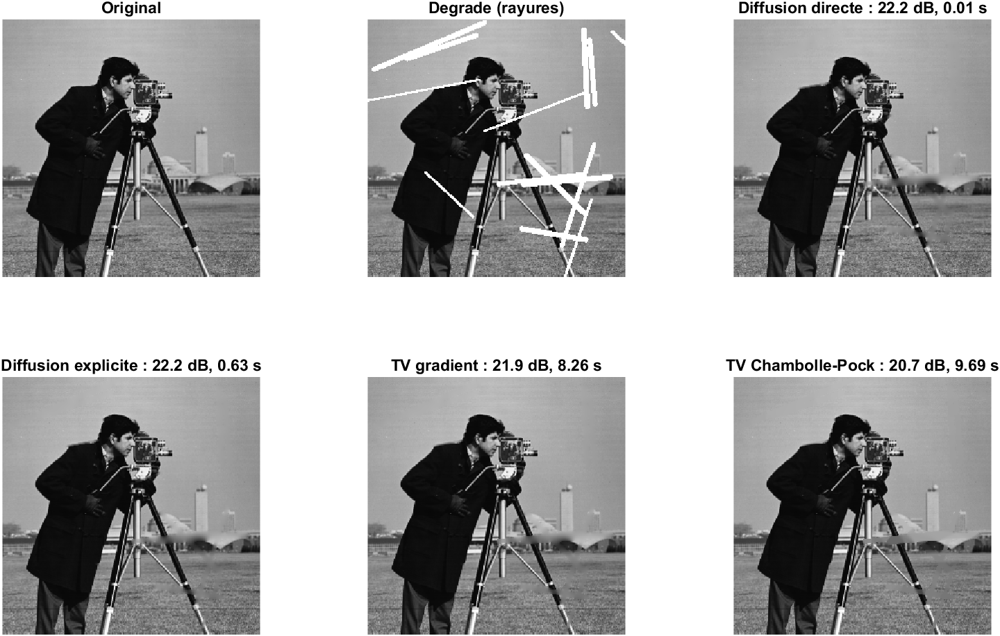
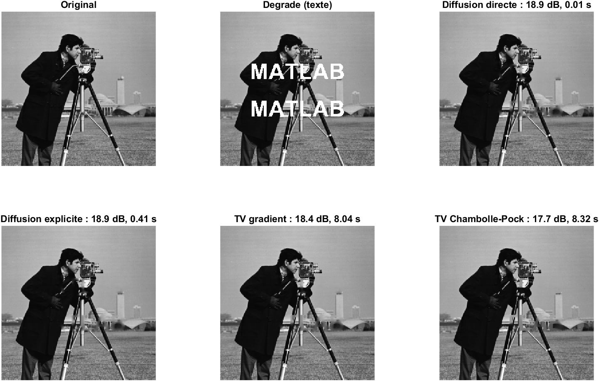

# Inpainting : diffusion harmonique vs variation totale

Reconstruction des pixels manquants d'une image (rayures, texte incrusté, objet à supprimer) par deux modèles variationnels : la **diffusion harmonique** et la **variation totale (TV)**. Chaque modèle est résolu par deux algorithmes, codés à la main en MATLAB **sans toolbox** :

| Modèle | Algorithmes |
|---|---|
| Diffusion harmonique | Système linéaire creux (solveur direct) ; schéma explicite |
| Variation totale | Descente de gradient sur une TV lissée ; Chambolle-Pock |




## 1. Problème

**Notations.**
- $`f`$ : l'image observée, de taille $`H \times W`$, à valeurs dans $`[0,1]`$.
- $`\Omega`$ : l'ensemble des pixels manquants, donné par le masque `mask`.
- $`u`$ : l'image reconstruite.

**Contrainte.** Hors du trou, on garde les pixels observés : $`u = f`$ sur $`\Omega^c`$.

**Problème.** On cherche l'image la plus régulière qui respecte cette contrainte :

```math
\min_{u}\; R(u) \quad \text{sous} \quad u = f \text{ sur } \Omega^c
```

Le masque est une **donnée** du problème. Dans les expériences, on part d'une image intacte et on fabrique le masque, ce qui permet de mesurer l'erreur par rapport à la vérité terrain.

**Opérateurs discrets.**

- **Gradient** (`grad_fwd`), par différences avant, avec une condition de Neumann (différence nulle sur la dernière colonne et la dernière ligne) :

  
  $`(\nabla u)_{ij} = \big(u_{i,j+1}-u_{ij},\; u_{i+1,j}-u_{ij}\big)`$
  

- **Divergence** (`div_bwd`) : elle est construite comme l'adjoint exact de $`-\nabla`$, c'est-à-dire $`\langle \nabla u, p\rangle = -\langle u, \mathrm{div}\,p\rangle`$ pour tous $`u`$ et $`p`$.

- **Norme du gradient** : $`\|\nabla\|^2 \le 8`$. En effet, $`(a-b)^2 \le 2a^2+2b^2`$, et chaque pixel intervient dans au plus 2 différences par direction. La borne est presque atteinte par un damier $`(-1)^{i+j}`$.

## 2. Diffusion harmonique

### Modèle

```math
R(u) = \sum_{ij} |\nabla u_{ij}|^2
```

La condition d'optimalité est $`\Delta u = 0`$ dans $`\Omega`$ : **chaque pixel inconnu vaut la moyenne de ses voisins**. Au bord de l'image, on fait la moyenne sur les voisins existants seulement (Neumann).

### Méthode directe

Les $`n`$ inconnues sont numérotées par `id(mask) = 1:n`. L'équation du pixel $`p_k`$ est :

```math
\deg(p_k)\,x_k - \sum_{\substack{q \in N(p_k) \\ q \in \Omega}} x_{\text{id}(q)} = \sum_{\substack{q \in N(p_k) \\ q \notin \Omega}} f_q
```

où $`N(p_k)`$ est l'ensemble des voisins de $`p_k`$ dans l'image, et $`\deg(p_k) = |N(p_k)| \in \{2,3,4\}`$.

- **Matrice $`A`$** : $`A_{kk} = \deg(p_k)`$, et $`A_{kl} = -1`$ si $`p_l`$ est un voisin inconnu de $`p_k`$.
- **Second membre $`b`$** : $`b_k`$ est la somme des voisins connus de $`p_k`$.

$`A`$ est symétrique définie positive dès que chaque composante du trou touche un pixel connu. Le code la construit sans boucle sur les pixels : 4 décalages, `sub2ind`, `accumarray`, puis `sparse`. Le système est résolu par `A \ b`.

### Méthode explicite (équation de la chaleur)

```math
u^{k+1} = u^k + dt\,\Delta u^k \quad \text{dans } \Omega
```

- **Laplacien** : il est calculé avec 4 images décalées dont les bords sont répliqués (Neumann).
- **Lien avec la méthode directe** : sur le trou, `lap` vaut exactement $`b - Ax`$. L'itération s'écrit donc $`x^{k+1} = x^k + dt\,(b - Ax^k)`$.
- **Convergence** : l'erreur vérifie $`e^{k+1} = (I - dt\,A)\,e^k`$. Comme $`\lambda(A) \in \,]0, 8]`$, il y a convergence pour $`dt < 1/4`$. Le code prend $`dt = 0{,}24`$.
- **Arrêt** : la boucle s'arrête quand $`\max_\Omega |b - Ax| < 10^{-4}`$, avec `nIter` comme garde-fou.
- **Coût** : pour un trou de côté $`L`$, $`\lambda_{\min} \approx 2\pi^2/L^2`$. Il faut donc environ $`1{,}5\,L^2`$ itérations pour diviser l'erreur par 1000. La méthode explicite devient inutilisable pour les grands trous.
- **Suivi de l'énergie** : à chaque itération, on enregistre $`E(u^k) = \sum|\nabla u^k|^2`$. Comme $`E(u) - E(u^*) = (x - x^*)^\top A\,(x - x^*)`$, cette quantité mesure l'erreur par rapport à la solution directe (figure 4).

## 3. Variation totale

### Modèle

```math
TV(u) = \sum_{ij} |\nabla u_{ij}| = \sum_{ij}\sqrt{(u_x)_{ij}^2 + (u_y)_{ij}^2}
```

**Pourquoi la TV préserve les contours.** Prenons un saut de hauteur $`h`$ dans un trou, étalé sur $`n`$ pixels :

| Critère | Coût du saut | Conséquence |
|---|---|---|
| Harmonique | $`h^2/n`$ | Diminue quand on étale : la solution floute le contour. |
| TV | $`h`$ | Indépendant de $`n`$ : un bord franc . |

**Interprétation géométrique.** La TV est égale à la somme des longueurs des lignes de niveau (formule de la coaire). À l'optimum, $`\mathrm{div}(\nabla u/|\nabla u|) = 0`$ dans $`\Omega`$, ce qui signifie que la courbure des lignes de niveau est nulle. Les contours sont donc **prolongés en ligne droite**.

### Descente de gradient sur la TV lissée (`'gd'`)

$`|\nabla u|`$ n'est pas dérivable en 0. On le remplace par une version lissée :

```math
J_\varepsilon(u) = \sum \sqrt{|\nabla u|^2 + \varepsilon^2}
```

**Gradient.** Par la règle de dérivation en chaîne, et avec $`\nabla^\top = -\mathrm{div}`$ :

```math
\frac{\partial J_\varepsilon}{\partial u} = -\mathrm{div}\!\left(\frac{\nabla u}{\sqrt{|\nabla u|^2+\varepsilon^2}}\right)
```

**Itération**, appliquée dans $`\Omega`$ seulement :

```math
u \leftarrow u + dt\;\mathrm{div}\!\left(\frac{\nabla u}{\sqrt{|\nabla u|^2+\varepsilon^2}}\right)
```

**Pas de temps.** La courbure de $`\sqrt{x^2+\varepsilon^2}`$ est au plus $`1/\varepsilon`$. La constante de Lipschitz du gradient vérifie donc $`L \le 8/\varepsilon`$, et la stabilité impose $`dt < 2/L = \varepsilon/4`$. Le code prend $`dt = \varepsilon/5`$.

**Rôle de $`\varepsilon`$** : c'est un seuil de contraste.
- Si $`|\nabla u| \ll \varepsilon`$, l'itération est approximativement $`u \leftarrow u + \tfrac15\Delta u`$ : on retrouve la diffusion harmonique.
- Si $`|\nabla u| \gg \varepsilon`$, on retrouve la vraie TV.

Diminuer $`\varepsilon`$ rapproche le résultat de la vraie TV, mais réduit le pas d'autant, donc demande plus d'itérations.

### Chambolle-Pock (`'cp'`)

**Reformulation duale.** Comme $`|g| = \max_{|p|\le1} p\cdot g`$, le problème devient un problème min-max :

```math
\min_{u \in C}\;\max_{|p_{ij}|\le 1}\;\langle \nabla u,\, p\rangle, \qquad C = \{u : u = f \text{ sur } \Omega^c\}
```

**Itération :**

```
p    ← proj_{|p|≤1}( p + σ ∇ū )          montée duale, puis projection p / max(1,|p|)
u⁺   ← proj_C( u + τ div p )              descente primale, puis remise de f hors du trou
ū    ← 2u⁺ − u                            extrapolation
```

- **Convergence** : elle est garantie si $`\sigma\tau\|\nabla\|^2 < 1`$. Le code prend $`\sigma = \tau = 0{,}99/\sqrt8`$.
- **Initialisation** : par la solution harmonique.
- **Conditions d'optimalité et critères d'arrêt.** L'arrêt intervient quand ces deux conditions sont satisfaites à $`10^{-4}`$ près :

| Condition | Résidu calculé | Rôle |
|---|---|---|
| $`\mathrm{div}\,p = 0`$ dans $`\Omega`$ | $`r_1 = \max_\Omega \|\mathrm{div}\,p\|`$, égal à $`\max\|u^+ - u\|/\tau`$ | $`u`$ est stationnaire. |
| $`p = \nabla u/\|\nabla u\|`$ là où $`\nabla u \ne 0`$ | $`r_2 = \big(TV(u) - \langle p, \nabla u\rangle\big)/TV(u) \ge 0`$ | $`p`$ est cohérent avec $`u`$. |

$`r_1`$ seul ne suffit pas, car $`p = 0`$ le vérifie pour n'importe quelle image.

## 4. Mesures de qualité

**PSNR**, mesuré **uniquement sur $`\Omega`$** :

```math
\text{PSNR} = 10\log_{10}\frac{1}{\frac{1}{|\Omega|}\sum_{\Omega}(u - \text{ref})^2}
```

Hors du trou, l'erreur est nulle par construction : l'inclure gonflerait le score.

**SSIM** (Wang et al., 2004). On utilise une fenêtre gaussienne de 11 × 11 et d'écart-type 1,5, avec $`C_1 = 0{,}01^2`$ et $`C_2 = 0{,}03^2`$ :

```math
\text{SSIM} = \frac{(2\mu_x\mu_y + C_1)(2\sigma_{xy} + C_2)}{(\mu_x^2+\mu_y^2+C_1)(\sigma_x^2+\sigma_y^2+C_2)}
```

Elle est moyennée sur toute l'image. **Limite** : la SSIM globale est optimiste pour les petits trous, car les fenêtres entièrement hors du masque valent 1.

## 5. Expériences et résultats

Image de test 256 × 256, `rng(1)`. Les 4 méthodes sont appliquées aux mêmes masques.

| Méthode | Arrêt | Maximum d'itérations |
|---|---|---|
| Diffusion directe | une seule résolution, pas d'itérations | – |
| Diffusion explicite | $`\max_\Omega \|\Delta u\| < 10^{-4}`$ | 20 000 |
| TV, descente de gradient ($`\varepsilon = 0{,}05`$) | nombre fixe d'itérations | 3 000 |
| TV, Chambolle-Pock | $`r_1 < 10^{-4}`$ et $`r_2 < 10^{-4}`$ | 5 000 |

Les temps sont mesurés après un appel de chauffe (compilation JIT exclue). Pour les méthodes de moins de 0,5 s, on garde la médiane de 5 exécutions. Les temps de la TV incluent l'initialisation par la solution harmonique directe.

| Figure | Contenu |
|---|---|
| `fig1_rayures.png` | 14 rayures aléatoires (demi-épaisseur 1 à 3 px) : original, dégradé et les 4 reconstructions |
| `fig2_texte.png` | Texte « MATLAB » incrusté |
| `fig3_taille_trou.png` | PSNR et temps de calcul des 4 méthodes en fonction du côté d'un trou carré (4 à 48 px) |
| `fig4_convergence.png` | À gauche, $`E(u_k) - E(u^*)`$ pour la diffusion explicite (échelle log). À droite, $`TV(u_k)`$ pour la descente de gradient et pour Chambolle-Pock. |
| `fig5_photo.png` | Suppression d'un objet sur une photo personnelle (optionnel) |

### Rayures et texte

| Masque | Méthode | PSNR (dB) | SSIM | Temps (s) | Itérations | ms / itération |
|---|---|---|---|---|---|---|
| Rayures (7,4 %) | Diffusion directe | **22.19** | 0.9793 | **0.010** | – | – |
| | Diffusion explicite | 22.18 | 0.9793 | 0.63 | 253 | 2.48 |
| | TV gradient | 21.90 | 0.9791 | 8.26 | 3 000 | 2.75 |
| | TV Chambolle-Pock | 20.68 | 0.9762 | 9.69 | 5 000 (max) | 1.94 |
| Texte (5,6 %) | Diffusion directe | **18.86** | 0.9830 | **0.008** | – | – |
| | Diffusion explicite | 18.86 | 0.9830 | 0.41 | 166 | 2.45 |
| | TV gradient | 18.44 | 0.9824 | 8.04 | 3 000 | 2.68 |
| | TV Chambolle-Pock | 17.66 | 0.9807 | 8.32 | 5 000 (max) | 1.66 |

### Trou carré de taille croissante

| Côté du trou (px) | 4 | 8 | 12 | 16 | 24 | 32 | 48 |
|---|---|---|---|---|---|---|---|
| PSNR diffusion directe (dB) | **14.59** | 17.97 | 14.08 | 15.08 | 12.72 | **13.09** | 12.76 |
| PSNR diffusion explicite (dB) | **14.59** | 17.97 | 14.07 | 15.06 | 12.69 | 13.07 | 12.73 |
| PSNR TV gradient (dB) | 13.58 | 17.66 | 16.74 | **16.34** | **12.92** | 13.03 | **12.79** |
| PSNR TV Chambolle-Pock (dB) | 12.92 | **18.04** | **17.02** | 14.36 | 12.76 | 10.91 | 10.33 |
| Temps diffusion directe (s) | 0.0016 | 0.0014 | 0.0027 | 0.0024 | 0.0023 | 0.0047 | 0.0067 |
| Temps diffusion explicite (s) | 0.086 | 0.22 | 0.46 | 0.62 | 1.29 | 2.36 | 3.42 |
| Temps TV gradient (s) | 7.03 | 7.20 | 7.07 | 7.20 | 8.51 | 7.60 | 7.48 |
| Temps TV Chambolle-Pock (s) | 2.66 | 2.80 | 3.32 | 2.62 | 4.48 | 5.57 | 6.73 |
| Itérations diffusion explicite | 42 | 120 | 212 | 327 | 598 | 942 | 1 658 |
| Itérations TV gradient | 3 000 | 3 000 | 3 000 | 3 000 | 3 000 | 3 000 | 3 000 |
| Itérations TV Chambolle-Pock | 5 000 | 5 000 | 5 000 | 5 000 | 5 000 | 5 000 | 5 000 |

### Analyse : vitesse

- **La diffusion directe est de loin la plus rapide** : 1 à 10 ms, soit 50 fois moins que le schéma explicite et 800 à 4 000 fois moins que les méthodes TV. Elle ne fait qu'une résolution creuse, sur les seuls pixels inconnus. Son temps n'augmente que faiblement avec la taille du trou (de 16 à 2 304 inconnues).
- **Le schéma explicite converge bien vers la solution directe** : même PSNR à 0,03 dB près. Mais il travaille sur l'image entière, à un coût constant d'environ 2,5 ms par itération, et son nombre d'itérations croît avec la largeur $`L`$ du trou : de 42 ($`L = 4`$) à 1 658 ($`L = 48`$), soit environ $`L^{1,5}`$ sur cette plage. Son temps passe ainsi de 0,09 à 3,4 s. Sur des trous fins (rayures, texte), 166 à 253 itérations suffisent.
- **La descente de gradient fait toujours 3 000 itérations**, car elle n'a pas de critère d'arrêt. Son temps est donc presque constant (7 à 8,5 s), quelle que soit la taille du trou.
- **Chambolle-Pock n'a jamais atteint son critère** $`r_1, r_2 < 10^{-4}`$ : il s'arrête à chaque fois sur le maximum de 5 000 itérations. Son temps reflète ce plafond, pas une convergence. Son coût par itération (1,7 à 1,9 ms sur les rayures et le texte) est inférieur à celui de la descente de gradient. À nombre d'itérations égal, son temps varie pourtant de 2,6 à 6,7 s selon la taille du trou : ces écarts ne s'expliquent pas par l'algorithme (le coût d'une itération ne dépend pas de la taille du trou) et relèvent probablement de la variabilité de la machine, avec une seule mesure par point.
- **Le temps des méthodes TV est donc fixé par leur règle d'arrêt** : un nombre fixe d'itérations pour la descente de gradient, un critère trop strict pour Chambolle-Pock. Assouplir la tolérance de Chambolle-Pock ou limiter les calculs au rectangle englobant du trou réduirait fortement ces temps.

### Analyse : qualité

- **Sur les rayures et le texte, la diffusion est la meilleure** (22,19 dB et 18,86 dB). Le PSNR baisse à mesure que la méthode se rapproche de la vraie TV : la descente de gradient, dont la TV lissée ($`\varepsilon = 0{,}05`$) se comporte encore comme une diffusion dans les zones peu contrastées, est intermédiaire ; Chambolle-Pock, qui minimise la vraie TV, est le plus bas. Sur une image naturelle avec des dégradés, les aplats de la TV coûtent plus que ce qu'apportent ses contours nets.
- **Sur les trous carrés de 12 et 16 px, la TV l'emporte** : +2,9 dB à 12 px (Chambolle-Pock) et +1,3 dB à 16 px (descente de gradient). Ces trous coupent des contours que la TV prolonge. À 8 px, l'avantage de Chambolle-Pock est négligeable (+0,07 dB).
- **Sur les grands trous (32 et 48 px), Chambolle-Pock se dégrade nettement** (10,3 à 10,9 dB, contre environ 13 dB pour les autres) : la TV remplit la zone d'aplats.
- **Le PSNR ne décroît pas régulièrement avec la taille du trou** (par exemple 17,97 dB à 8 px contre 14,59 dB à 4 px pour la diffusion) : chaque carré, centré, recouvre un contenu différent de l'image, et la difficulté dépend autant de ce contenu que de la taille.
- **La SSIM varie très peu** (0,976 à 0,983), car elle est calculée sur toute l'image, dont plus de 92 % des pixels sont identiques à l'original.

## 6. Lancer le projet

```matlab
>> cd chemin/vers/inpainting-harmonic-tv
>> main
```

- MATLAB R2021a ou plus récent, sans aucune toolbox.
- **Image de test** : `cameraman.tif` ou `peppers.png` si elles sont disponibles, sinon une image synthétique. L'image est recadrée au centre puis rééchantillonnée en 256 × 256.
- **Masque texte** : il est obtenu en dessinant le texte dans une figure invisible, puis en la capturant avec `getframe`. Sans affichage graphique, le script utilise des rayures à la place.
- **Suppression d'objet** : placez `data/photo.png` ou `.jpg`. Ajoutez éventuellement `data/masque.png` (blanc = à supprimer, accepté en 0/1 ou 0/255) ; sinon, cliquez un polygone autour de l'objet. La photo est réduite à 800 px au maximum, puis chaque canal couleur est reconstruit par TV.

Utilisation directe des fonctions :

```matlab
u = inpaint_harmonic(f, mask, 'direct');
[u, E]  = inpaint_harmonic(f, mask, 'explicit', 5000);    % E : énergie à chaque itération
[u, tv] = inpaint_tv(f, mask, 'cp', 2000);                % arrêt sur r1, r2 < 1e-4
[u, tv] = inpaint_tv(f, mask, 'gd', 2000, struct('eps', 0.02));
```

## 7. Structure

```
main.m                    toutes les expériences et figures
src/grad_fwd.m            gradient discret (différences avant, Neumann)
src/div_bwd.m             divergence discrète, adjointe de -grad_fwd
src/inpaint_harmonic.m    diffusion : solveur direct creux, schéma explicite avec arrêt sur le résidu
src/inpaint_tv.m          TV : descente de gradient lissée, Chambolle-Pock avec arrêt sur r1 et r2
src/make_mask.m           masques : rayures, texte, trou carré, pertes aléatoires
src/quality.m             PSNR dans le trou, SSIM
src/load_test_image.m     image de test (recadrage carré, rééchantillonnage)
src/save_fig.m            export des figures
```

## 8. Limites et pistes

- **Textures** : utiliser l'inpainting par patchs (Criminisi, PatchMatch).
- **Effet d'aplats de la TV** : utiliser la TV généralisée (TGV).
- **Trous larges** : utiliser des modèles d'ordre supérieur, qui prolongent aussi la courbure des contours (Euler elastica, CDD).
- **Couleur** : remplacer le traitement canal par canal par une TV vectorielle couplant les canaux.

## Lien avec mes autres projets

Même cadre que la [déconvolution variationnelle](https://github.com/lachance123-franccois/deconvolution-variational-to-unrolled) : un terme d'attache aux données (ici une contrainte dure), un terme de régularisation (Tikhonov ou TV) et un algorithme d'optimisation proximale.

## Licence

MIT